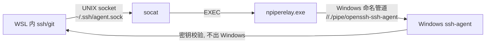

# SSH 密钥共享：WSL 复用 Windows SSH Agent

让 WSL 内的 `git`/`ssh` 直接使用 **Windows 上的 ssh-agent**，密钥全程不离开 Windows，符合「SSH 私钥不入库」的安全边界。

## 原理



- **Windows 侧**：`ssh-agent` 服务持有私钥（`ssh-add` 后常驻内存）。
- **WSL 侧**：`~/.zshenv` 中的 `eval "$(dsync shell-init zsh)"` 把 `SSH_AUTH_SOCK` 指向本地 UNIX socket，并懒启动 `socat`，把 socket 上的认证请求通过 `npiperelay.exe` 转发到 Windows 的命名管道。

## 组成

| 组件 | 位置 | 作用 |
|---|---|---|
| Windows ssh-agent 服务 | `dsync host setup` 的 ssh-agent 步骤 | 启动服务并设为自动，可选 `ssh-add` 默认密钥 |
| `socat` | `dsync provision` 的 apt 步骤（dsync.toml [packages]） | WSL 侧 socket 转发 |
| `npiperelay.exe` | `dsync provision` 的 wsl-ssh-agent 步骤 → `~/.local/bin/` | WSL→Windows 命名管道桥接 |
| `SSH_AUTH_SOCK` 导出 + 懒启动 | `dsync shell-init`（`~/.zshenv` 中 eval） | 所有 zsh 会话（含非交互）可用 |

## 首次使用（Windows 侧，管理员 PowerShell）

`dsync host setup` 会自动启用服务。若需要手动操作或更换密钥：

```powershell
Set-Service -Name ssh-agent -StartupType Automatic
Start-Service ssh-agent
# 把密钥加入 agent（每把密钥一次；WSL 即可免密使用）
ssh-add "$env:USERPROFILE\.ssh\id_ed25519"
```

> 若提示找不到 ssh-agent 服务：设置 → 应用 → 可选功能 → 添加「OpenSSH 客户端」，或
> `Add-WindowsCapability -Online -Name OpenSSH.Client~~~~0.0.1.0`

## WSL 侧（自动）

- `dsync provision`（apt 步骤）安装 `socat`；
- `dsync provision`（wsl-ssh-agent 步骤）下载 `npiperelay.exe` 到 `~/.local/bin`（仅在 WSL 内执行，非 WSL/CI/容器自动跳过）；
- `dsync shell-init`（由 `~/.zshenv` eval）自动完成 `SSH_AUTH_SOCK` 导出与 socat 懒启动。

若 GitHub 下载被墙，请先配好本地代理（`dsync config set proxy.http … proxy.https …`，见 [usage-guide.md](usage-guide.md#6-本机配置-localtoml)；新开终端生效）再重跑
`dsync provision --only wsl-ssh-agent`（或直接手动把 `npiperelay.exe` 放到 `~/.local/bin/` 并 `chmod +x`）。

## 验证

```bash
echo $SSH_AUTH_SOCK        # 应输出 ~/.ssh/agent.sock
ssh-add -l                 # 应列出 Windows 侧添加的密钥
ssh -T git@github.com      # 返回欢迎语即成功
dsync doctor               # 末尾会显示 SSH Agent 健康检查
```

## macOS

macOS 使用系统 Keychain agent，无需任何配置；`dsync shell-init` 只在 WSL 中输出这一段。

## 故障排查

| 现象 | 处理 |
|---|---|
| `ssh-add -l` 报 `Error connecting to agent: Connection refused` | **残留 socket**：`~/.ssh/agent.sock` 文件还在但 socat 没在监听（WSL 重启/进程被杀后遗留）。`rm -f ~/.ssh/agent.sock` 后重开终端（`dsync shell-init` 会自动重新拉起 socat，并清理残留 socket） |
| `ssh-add -l` 报 `Could not open a connection to your authentication agent` | socket 未建立：确认在 **WSL** 内（非原生 Linux），且 `npiperelay.exe` 已存在于 `~/.local/bin`；重开终端 |
| `ssh -T git@github.com` 仍要密码/被拒 | Windows 侧 agent 中没有该密钥：`ssh-add ~/.ssh/id_ed25519`（需先在 Windows 端生成/放入密钥） |
| WSL 里能看到 socket 但 `ssh-add -l` 为空 | Windows ssh-agent 服务未运行：`Get-Service ssh-agent`，若停止则 `Start-Service ssh-agent` |
| 代理已配但 npiperelay 下载仍失败 | `curl -fsSL -o ~/.local/bin/npiperelay.exe <下载地址>` 带代理手动下载，再 `chmod +x` |
